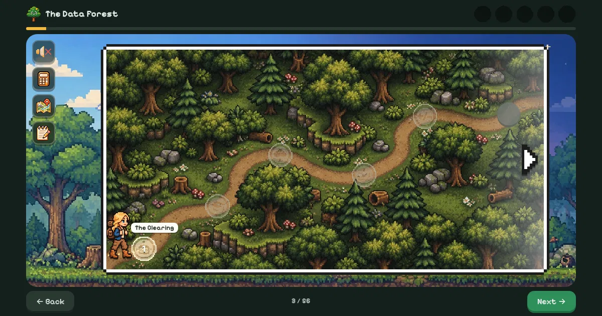

# The Data Forest

A retro pixel-art learning game about AI and machine learning. You hike through a forest, one level per topic, solve hands-on tasks, and earn bronze, silver or gold coins in checkpoint quizzes.

**▶ Play it here:** https://mir4clemi.github.io/data-forest/

## What you learn
| Level | Topic |
|---|---|
| 1 · The Clearing | What AI is: ANI, AGI, ASI, generative and agentic AI, use cases |
| 2 · The Crossroads | Types of machine learning: supervised, unsupervised, reinforcement |
| 3 · The Lone Tree | Decision trees: Gini impurity, splits, pruning |
| 4 · The Deep Forest | Random forests: bootstrapping, feature randomness, majority vote |
| 5 · The Watchtower | Evaluation: hold-out, k-fold cross-validation, confusion matrix, precision and recall, cost-based model choice |
| 6 · Ranger's Exam | Final quiz and certificate |

## Features
- Story-driven levels with a guide character (Twig) who reacts to your answers
- Interactive tasks: sorting, sliders, flip cards, a built-in calculator, exam-style quizzes
- Star rating per level (bronze, silver, gold) based on first-try answers
- Two playable avatars, trail map with walking and zoom animations, music and sound effects
- Progress is saved in your browser, so you can come back anytime
- Works on desktop and mobile. It is one self-contained HTML file with no install and no tracking

## About
Designed by Emi, a learning designer, as an independent study aid for classmates and as a portfolio project on game-based learning.

*Independent study aid. Not affiliated with or endorsed by any university or instructor.*
